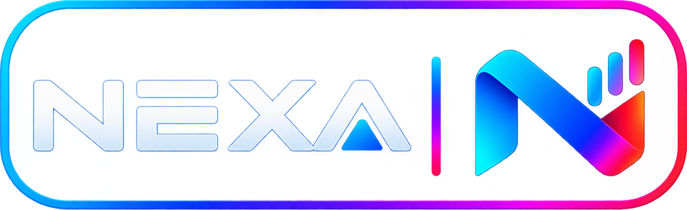

<div align="center">
  
  <h1>NEXA — Chrome New Tab Dashboard</h1>
  <p>A modern, customizable personal dashboard for your Chrome new tab.</p>
  <p>
    
    
    
  </p>
</div>

NEXA replaces Chrome's default New Tab page with a customizable workspace for everyday tools and information. It is built with plain HTML, CSS, and JavaScript and can be loaded as an unpacked Chrome extension without a build process.

> **Project status:** Personal/development release `0.6.1`. Some data depends on third-party services and may be unavailable due to provider outages, rate limits, network restrictions, or CORS/access policies. Account-based cloud synchronization is not included in this release.

## Features

- Digital clock with seconds and date display
- World clocks and configurable time zones
- Weather, forecast, UV, humidity, wind, and air-quality information
- Public IP/network information widgets
- Quick tasks with 25%, 50%, 75%, and 100% progress levels
- Built-in calculator
- Cryptocurrency prices
- Forex reference rates
- Iranian domestic market prices
- RSS news feeds, including user-added feeds
- Bookmark tiles with website favicons
- Drag-and-drop widget arrangement and widget visibility/size controls
- Custom wallpapers and photo-frame/slideshow features
- Google and DuckDuckGo search options
- Local persistence for supported preferences and user-created content
- Reload controls for supported market and news widgets

## Install in Chrome

1. Download this repository as a ZIP using **Code → Download ZIP**, or clone it with Git.
2. Extract the ZIP completely. Do not select the ZIP file itself in Chrome.
3. Open `chrome://extensions` in Google Chrome.
4. Enable **Developer mode**.
5. Click **Load unpacked**.
6. Select the extracted `NEXA` folder—the folder that contains `manifest.json` directly.
7. Open a new tab to use NEXA.

### Updating an existing local installation

Download and extract the new version to a stable folder, then use **Reload** on the extension card at `chrome://extensions`. If you choose a different folder, load that folder with **Load unpacked**. Keep the folder in place while using the extension.

## Repository structure

```text
NEXA/
├── .github/
│   ├── ISSUE_TEMPLATE/
│   └── workflows/
├── icons/
│   ├── icon16.png
│   ├── icon48.png
│   └── icon128.png
├── app.js
├── style.css
├── newtab.html
├── manifest.json
├── logo.png
├── README.md
├── CHANGELOG.md
├── CONTRIBUTING.md
├── SECURITY.md
├── PRIVACY.md
├── STORE_LISTING.md
├── LICENSE
└── .gitignore
```

## Data and privacy

NEXA stores supported dashboard settings and user-created data locally in Chrome storage. Widgets may send requests directly to third-party providers to retrieve the information they display. RSS feed URLs are user-configurable, and those feeds may be hosted by third parties.

Review [PRIVACY.md](PRIVACY.md) for a summary of data handling and external services. Avoid adding private credentials, API secrets, or personal data to source files or public issues.

## Third-party services

Depending on the widget and network availability, NEXA may use services such as Open-Meteo, CoinGecko, Frankfurter, TGJU, Google News RSS, and user-selected RSS providers. These services have their own availability, usage limits, and terms. NEXA does not guarantee that third-party data is complete, real-time, or suitable for financial decisions.

## Roadmap

Potential future improvements include:

- Account-based cross-device synchronization
- More flexible market symbol selection
- Expanded accessibility and localization
- Further Chrome Web Store preparation
- Optional premium features

Roadmap items are plans, not features included in the current release.

## Contributing and feedback

Bug reports and focused suggestions are welcome. Please read [CONTRIBUTING.md](CONTRIBUTING.md) before opening an issue or pull request. For security-sensitive reports, follow [SECURITY.md](SECURITY.md) rather than posting details publicly.

## License

The current license is **source-available, all rights reserved**; it is not an open-source license. You may view the code on GitHub, but copying, modifying, redistributing, or selling it requires permission from the copyright holder. See [LICENSE](LICENSE).
